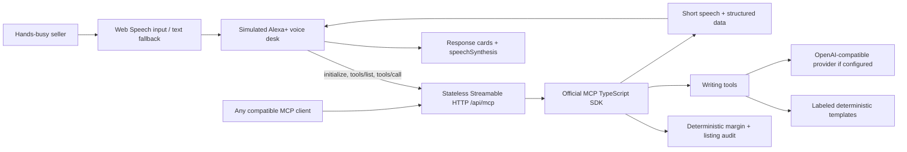

# Seller Voice

**Hands busy. Business moving. A voice-first MCP assistant for small online sellers.**

[Try the live voice desk](https://seller-voice-mcp.vercel.app) · [MCP endpoint](https://seller-voice-mcp.vercel.app/api/mcp) · [Demo screens](media/01-voice-desk.png)

Small sellers pack orders, photograph products and manage ads themselves. Switching to a spreadsheet or a blank copywriting document interrupts the work. Seller Voice turns a short request into a spoken answer and a useful screen card: calculate a margin, flag risky wording or draft the next piece of content.

The web app is an **Alexa+ experience simulation**, independently built without Amazon branding. It is also a real, self-hosted MCP server. Every answer in the simulation comes from a real `tools/call` over Streamable HTTP, with the request and response visible in the activity panel. No Alexa device or Amazon account is needed to try it.

## Tools

| Tool | Input | Result |
| --- | --- | --- |
| `margin_check` | Price, cost; optional fee %, shipping, ad cost and currency | Unit profit, margin, break-even ROAS and warnings |
| `listing_audit` | Listing text; optional material, dimensions, shipping and returns fact fields | English/Korean claim flags and missing fact fields |
| `ad_headlines` | Product, known facts, optional audience | Three distinct selling angles, each at most 40 characters |
| `shorts_script` | Product, known facts, optional audience | Two-second hook, contiguous 30-second beats, visuals, voiceover and on-screen text |
| `detail_page_outline` | Product, known facts, optional audience | Page sections and information to verify |

Each successful tool returns `{ speech, data, mode }` in both `structuredContent` and a JSON text block. Speech is at most two sentences. The first two tools are deterministic. The other three return labeled **demo templates** without an API key, and automatically use the configured provider when `LLM_API_KEY` exists. A failed live request returns `mode: "demo-fallback"`, a deterministic template, and a visible notice explaining that the result is not live AI output. Invalid inputs remain MCP tool errors.

Example: “What's my break-even ROAS if I sell at 29,000 won with 11,000 cost?” gives **₩18,000 unit profit, 62.1% margin, 1.61× ROAS**, with fees, shipping and ads defaulting to zero. Add “fee 5, shipping 3000, ad cost 4000” to include those expenses. Money inputs must share a currency. Taxes, overhead and returns are excluded. ROAS uses profit **before** ad spend; it does not change when ad cost changes.

The browser uses a deliberately small, deterministic English intent router, not an undisclosed LLM. Use the suggested prompts or the documented phrases. Writing requests use “for [product]”; edit the known facts in settings when switching products. The API supports richer structured inputs from any MCP client. Listing screening is a limited pattern check, not legal approval; quotes and negations can be flagged, and absent fact fields are reported even if the listing mentions them.

Writing inputs allow a product name up to 100 characters, facts up to 3,000, and an audience up to 200. Drafts must be reviewed before publication.

## Sponsor technology and architecture

Seller Voice targets the Alexa+ track through the simulated voice experience and a standards-based MCP server. The official **MCP TypeScript SDK is pinned to 1.32.1**, which supports protocol **2025-11-25**. Each request creates and closes its own SDK server and Streamable HTTP transport, with JSON responses, no session store and no persistent SSE connection. This fits Vercel functions.



## Run and test

Node **22** is used for the application and CI.

```sh
npm ci
cp .env.example .env
# Optional: fill .env, then export its values in your shell.
# Node can load it directly:
node --env-file=.env --import tsx src/local.ts
# Or npm start when environment variables are already exported.
```

Open `http://127.0.0.1:3000`. `npm run dev` provides server reloads. `.env` is not loaded by `npm start`; use the command above or your hosting provider's environment settings.

```sh
npm run typecheck
npm test
gitleaks detect --source . --redact
gitleaks git --redact
```

Tests cover math boundaries and expense handling, risky claims, missing facts, deterministic templates, mocked OpenAI-compatible request/response validation, reasoning-only answers, tolerant JSON extraction, timeout/network/HTTP fallback, safe token usage, protocol negotiation, all five tools through the official SDK HTTP client, bearer auth and Origin rejection. Mocked provider tests do not demonstrate live provider access.

Verified delivery: 20 tests and TypeScript pass. Production browser automation called all five tools successfully. See [capture evidence](media/verification.json). Microphone access, physical-device speech and actual Alexa+ account connection remain untested.

For browser verification and real screen assets on a machine with Chromium:

```sh
npx playwright install chromium
npm start
# In another terminal:
npm run capture
# Or CAPTURE_URL=https://seller-voice-mcp.vercel.app npm run capture
```

The capture script runs all five tools over the actual HTTP connection, verifies mobile layout at 390 px, and saves screenshots, raw WebM and `media/verification.json`. Committed PNGs are original app captures; large raw video is kept outside git for editing. The final narrated submission video is not included or uploaded by this project.

## Configuration

| Variable | Behavior |
| --- | --- |
| `LLM_BASE_URL` | Default `https://api.tokenfactory.nebius.com/v1/` |
| `LLM_API_KEY` | Empty means demo templates; set means live writing requests |
| `LLM_MODEL` | Default `nvidia/Nemotron-3_5-Lightning`; set a model available in your account |
| `MCP_AUTH_TOKEN` | Optional shared bearer token for compatible MCP clients |
| `MCP_ALLOWED_ORIGINS` | Optional comma-separated additional exact browser origins |
| `PORT` | Local port, default 3000 |

## Live mode

Production verification uses real browser MCP `tools/call` requests and requires `mode: "live"` for all three writing tools. Fresh 1920×1080 results, per-tool usage and panel coordinates are in [media/verification.json](media/verification.json); raw WebM/MP4 stays untracked in `media/`. The same capture checks all five tools and a 390-pixel mobile layout. These are browser/MCP results, not Alexa device validation.

Production uses Nebius Token Factory with `nvidia/Nemotron-3_5-Lightning`. Keys live only in the hosting environment. Requests disable thinking with `chat_template_kwargs: { enable_thinking: false }` and `/no_think`, use JSON mode, and cap headline output at 300 tokens (scripts/outlines: 1,600). Tool-specific examples teach ordinary-use invitations and varied angles without inventing benefits. A deterministic screen rejects new numerals and known unsupported claims; a separate model pass reviews factual support. Rejected drafts get one revision, then a clearly labeled demo fallback. Review calls are capped at 500 tokens. These checks reduce mistakes; they cannot prove semantic grounding. Review every draft before publishing.

The client reads final `message.content`, strips `<think>` blocks, extracts JSON from fenced/wrapped answers and validates the tool schema. Separate reasoning is never displayed. Numeric usage counts include drafting, review and any revision. HTTP errors, timeouts, missing final answers and invalid drafts show a **DEMO FALLBACK · LIVE UNAVAILABLE** label and notice.

The client uses the [documented OpenAI-compatible API](https://docs.tokenfactory.nebius.com/quickstart) (`messages`, `model`, `response_format`; `choices[0].message.content` response), HTTPS and a 10-second timeout per request (at most four sequential requests). Another compatible provider can be selected entirely through environment variables. Confirm your chosen model supports JSON responses. No provider key is bundled or sent to the browser.

Run the live writing regression screen (five tool calls across three products):

```sh
EVAL_URL=https://seller-voice-mcp.vercel.app/api/mcp npm run eval:live
# Or export LLM_API_KEY to evaluate the configured provider directly.
CAPTURE_URL=https://seller-voice-mcp.vercel.app REQUIRE_LIVE=1 npm run capture
```

The eval checks schemas, 40-character headlines, distinct openings, word overlap, supplied numerals, known unsupported claims and cross-product leakage. It prints drafts for human review; passing these bounded checks does not prove every implied claim is grounded. Browser capture must run on pilot; it records smooth typed requests and real responses without intercepting the API.

When enabling live writing on a public deployment, configure `MCP_AUTH_TOKEN` to control who can use your provider key. The web app accepts that token in settings, keeps it in the current tab only and sends it in the Authorization header. It is never embedded in JavaScript, local storage, URLs or the activity payload. Same-origin browser requests are accepted; unrelated Origins are rejected. There is no durable rate limiter or multi-user account system.

Web Speech recognition depends on browser support, microphone permission and a secure context; text input always remains available. Speech recognition may use your browser vendor's service. Replies can be read with the opt-in Audio button. Product facts go to the configured LLM only in live mode. This app has no database and publishes no content or changes to seller accounts; hosting/provider logs are controlled by those services.

## Connect an MCP client

Remote endpoint: **`https://seller-voice-mcp.vercel.app/api/mcp`** (also available at `/mcp`). A GET response of 405 is expected: this stateless server uses POST and does not offer a standalone SSE stream.

For clients that accept remote MCP server configuration:

```json
{
  "mcpServers": {
    "seller-voice": {
      "type": "http",
      "url": "https://seller-voice-mcp.vercel.app/api/mcp"
    }
  }
}
```

Configuration formats vary by client. In Claude Desktop with remote connectors enabled, use **Settings → Connectors → Add custom connector** and enter the HTTPS endpoint. That UI and availability depend on the owner's plan; this is not a local stdio configuration. For a token-protected deployment, use a client that supports custom `Authorization: Bearer <your token>` headers. Static bearer auth here is a shared-secret option, **not OAuth account linking**.

Inspect with the official CLI:

Inspector 2.11.0 declares Node 22.19 or later; use a compatible Node version for its CLI.

```sh
npx @modelcontextprotocol/inspector@2.11.0 --cli https://seller-voice-mcp.vercel.app/api/mcp --transport http --method tools/list
npx @modelcontextprotocol/inspector@2.11.0 --cli https://seller-voice-mcp.vercel.app/api/mcp --transport http --method tools/call --tool-name margin_check --tool-arg price=29000 --tool-arg cost=11000
```

## Connect to Alexa+

Actual Alexa+ connection requires the owner's developer/AWS accounts and access to Amazon's developer tooling; it has **not been tested**. The working web simulation is the immediately reviewable hackathon path. Per the official Alexa+ MCP quickstart, use the separate developer toolkit environment (Node **24+**, unlike this app's Node 22 runtime):

```sh
alexa-ai configure
alexa-ai new mcp --name "Seller Voice" --locale en-US --mcp-server-url "https://seller-voice-mcp.vercel.app/api/mcp"
alexa-ai deploy
```

Complete the generated manifest, including descriptions, example phrases, privacy/terms URLs and required media. Redeploy the add-on when tools change. Generic tools can connect without account linking, so leave `MCP_AUTH_TOKEN` unset for that path. Alexa+ account linking requires OAuth 2.1 with PKCE S256 and metadata endpoints, which this shared-token server does not implement. The docs' latency guidance still needs evaluation for live LLM tools. Do not treat a successful browser demo as proof of Alexa device integration.

Sources checked for this entry: [hackathon rules](https://amazonappdev2026.devpost.com/rules), [resources](https://amazonappdev2026.devpost.com/resources), [Alexa+ MCP quickstart](https://developer.amazon.com/docs/alexaplus/add-ons/mcp-toolkit-quickstart), [development setup](https://developer.amazon.com/docs/alexaplus/add-ons/set-up-your-development-environment), [account linking](https://developer.amazon.com/docs/alexaplus/add-ons/mcp-toolkit-account-linking.html), [MCP transport specification](https://modelcontextprotocol.io/specification/2025-11-25/basic/transports), [Nebius OpenAPI schema](https://api.tokenfactory.nebius.com/openapi.json), [Gemini compatibility docs](https://ai.google.dev/gemini-api/docs/openai).

## Deploy

```sh
vercel --prod --yes
```

Set optional secrets through the hosting environment, never committed files. The static interface is in `public/`; Vercel compiles the TypeScript functions in `api/`. The GitHub Actions workflow runs TypeScript checks and tests on pushes and pull requests. The application source is public. No database or paid dependency is required for demo mode.

## What was built during the hackathon

Built for the October 2026 Amazon Developer Hackathon: the new Seller Voice MCP server, all five registered tools, stateless HTTP/auth layer, OpenAI-compatible generation with schema validation, deterministic draft templates, voice desk, MCP client activity display, tests, CI, deployment configuration and original screen captures.

Reused from our own MIT project [commerce-content-engine](https://github.com/kks0488/commerce-content-engine): the `computeMargin` formula in `src/core.js`, ported with attribution into `src/core.ts`. This prior calculation is explicitly not claimed as newly invented hackathon work. No third-party product content, media or logos were used. The Open Source mini challenge describes an additional new project/contribution; this public repository provides an OSS contribution, but eligibility is for the organizers to determine. Nothing is submitted automatically to Devpost.

## License

[MIT](LICENSE) · Copyright (c) 2026 Kyoungsoo Kim.
